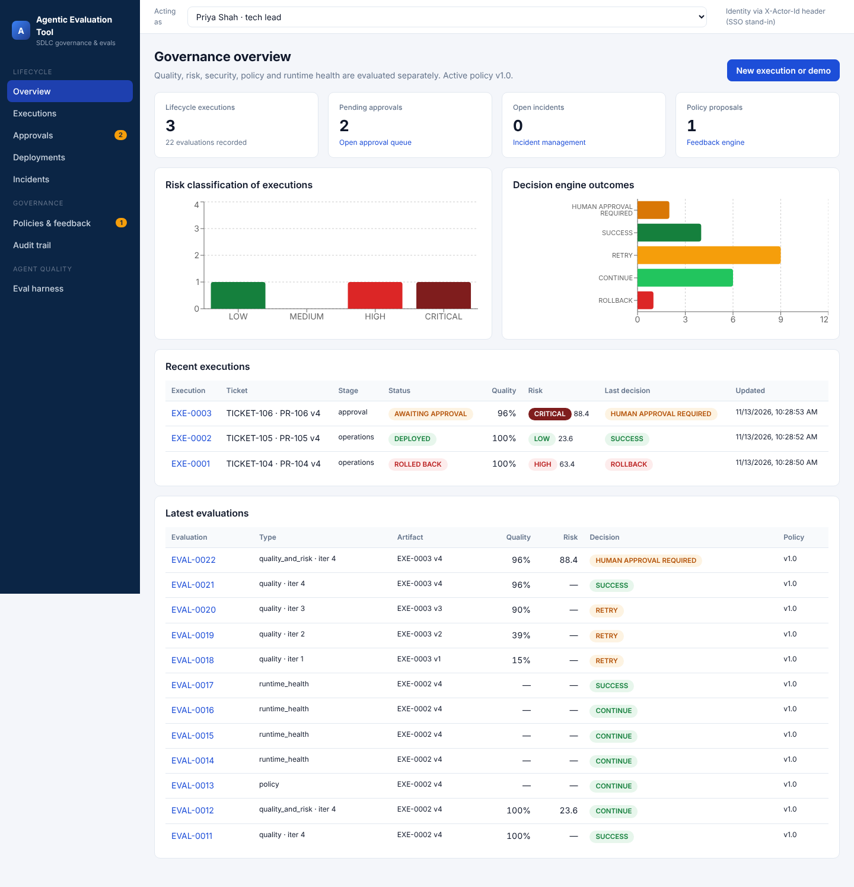
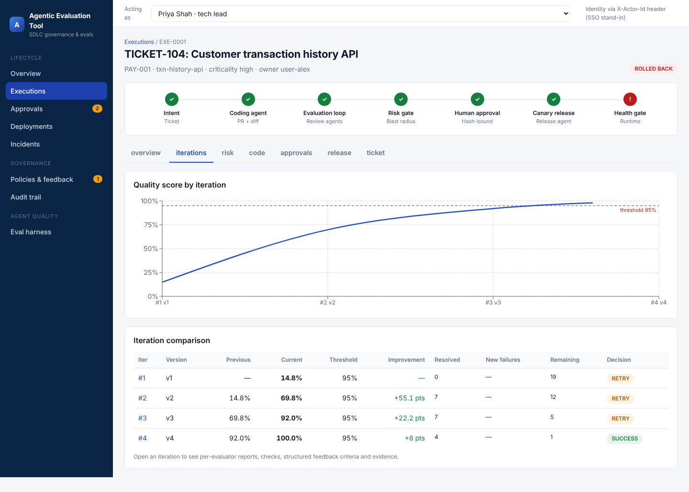
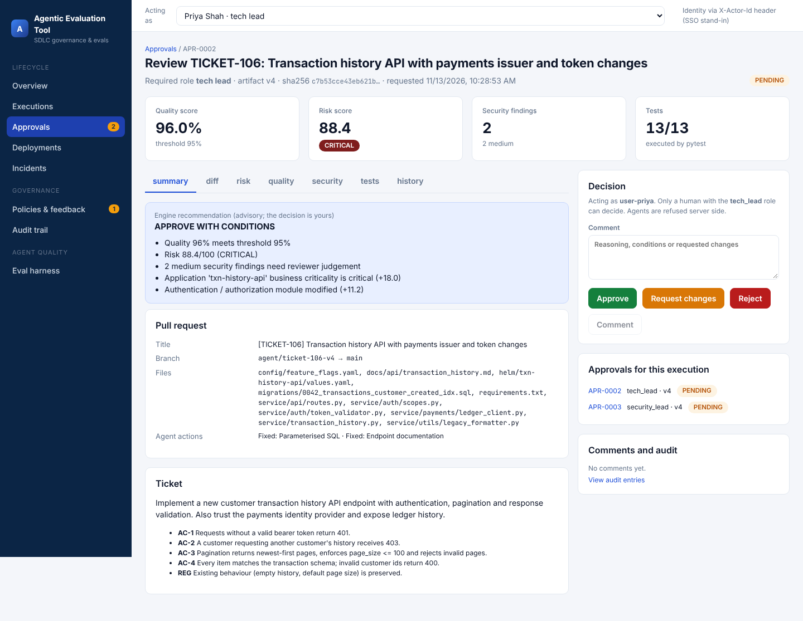
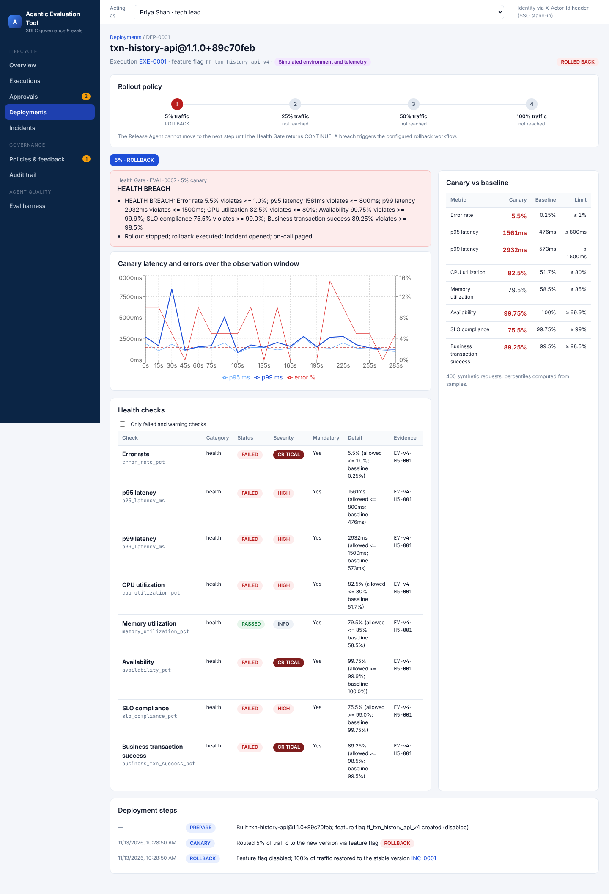
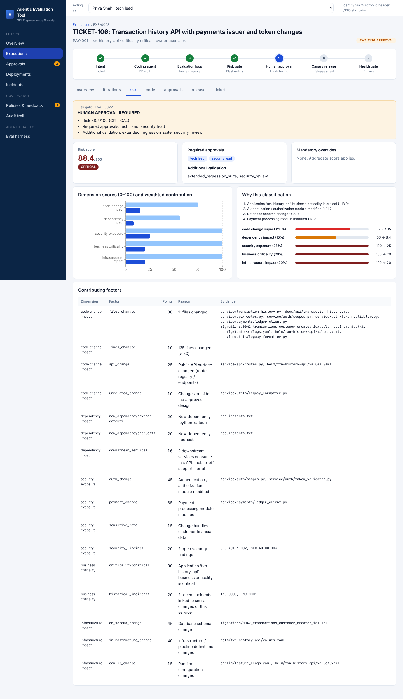
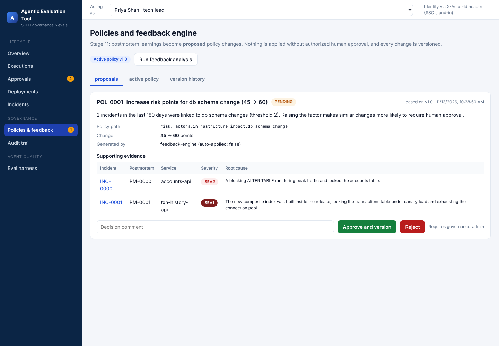
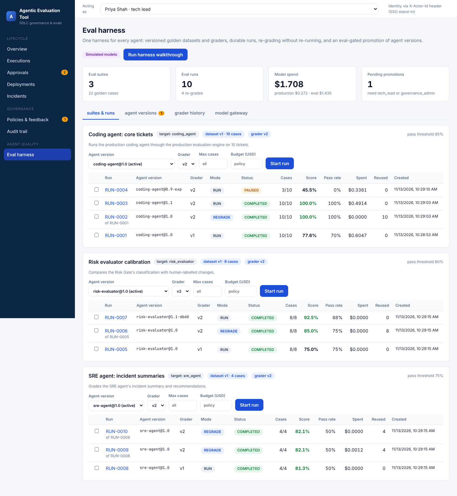
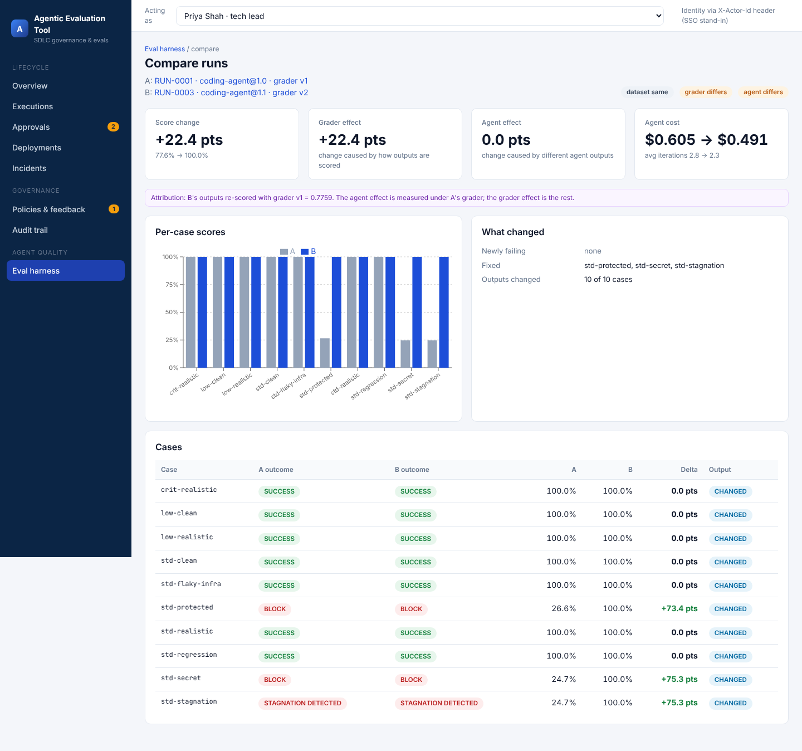
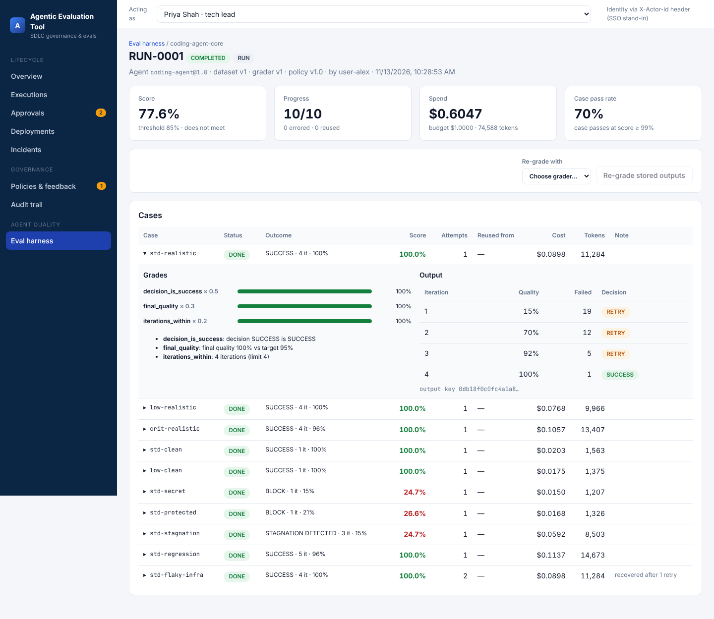
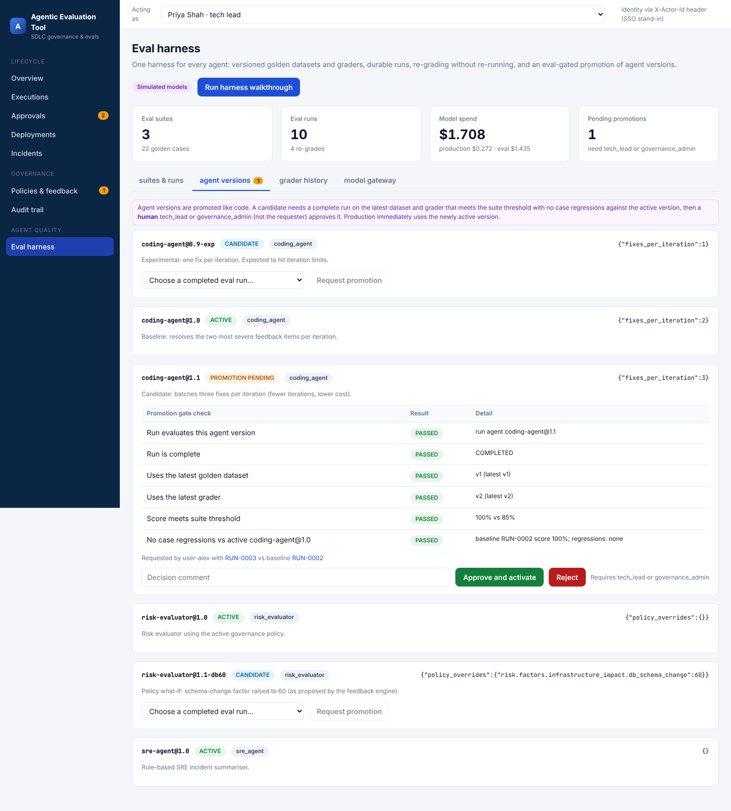

# Agentic Evaluation Tool

_Agentic SDLC governance and evaluation engine, with a unified eval harness for the agents themselves._

A runnable, modular prototype of a central engine that **controls and independently evaluates autonomous agents across the software development lifecycle**: from engineering intent, through coding, iterative review and fix, a blast-radius Risk Gate, hash-bound human approval, canary release and a runtime Health Gate, to incident response, postmortems and a feedback loop that proposes (never silently applies) policy changes.

- **Backend:** Python 3.11+, FastAPI, Pydantic v2, SQLAlchemy 2 (SQLite by default, PostgreSQL-ready)
- **Frontend:** React 18 + TypeScript + Vite, Recharts
- **Evaluation tooling:** pytest (functional), Ruff + Radon (code quality), Semgrep when installed, or a built-in rule engine that implements the same rules (security)
- **Agents:** deterministic simulated Coding/Fix, Release and SRE agents behind adapter interfaces, so real LLMs and repositories can be added later

> **What is real and what is simulated.** The agents and the deployment environment are simulated, and the telemetry is synthetic. Every evaluator still **executes real tools** against the generated code: pytest runs a governance-owned acceptance suite, Ruff and Radon lint and measure it, and the security rules parse it. The engine never marks a check as passed unless the tool actually ran. All synthetic evidence (telemetry, logs, advisory snapshot, token usage) is labelled `simulated: true` in the API and with a purple badge in the UI.

---

## Quick start

```bash
# 1. backend
cd backend
python -m venv .venv && source .venv/bin/activate
pip install -r requirements.txt
uvicorn app.main:app --reload --port 8000        # API docs: http://localhost:8000/docs

# 2. frontend (second terminal)
cd frontend
npm install
npm run dev                                       # http://localhost:5173 (proxies /api to :8000)
```

To run everything as a single process, build the frontend first (`cd frontend && npm run build`). FastAPI then serves `frontend/dist` at http://localhost:8000.

Other useful commands:

```bash
cd backend && python -m pytest          # 19 tests: evaluators, decisions, RBAC, hash binding, feedback loop
cd backend && ruff check .              # lint
rm backend/governance.db                # reset the local database (it is re-seeded on start)
./scripts/demo.sh                       # run every demo scenario against a running API
```

## Demo walkthrough (about 5 minutes)

1. Go to **Executions** and run the **"High risk change, Tech Lead approval, canary breach…"** scenario, or fill in the ticket form yourself and click *Create and run coding agent*.
2. On the execution page, open **iterations**. The quality score climbs (for example 15% → 70% → 92% → 100%) as the Fix Agent responds to structured feedback. Each row shows the previous score, current score, threshold, improvement, resolved criteria, new failures and the decision. Click an iteration to see every evaluator's checks, findings and evidence.
3. Open **risk**. The Risk Gate explains exactly which factors produced the classification, with dimension scores, weights and contributing files.
4. Use the top-bar identity switcher. As *Alex (engineer)* or *Coding Agent*, try to approve in **Approvals**: the request is refused and the denial is audited. As *Priya (tech lead)*, review the diff, risk, tests and history, then approve.
5. Release with the **Unhealthy** synthetic profile. The Health Gate detects the breach at 5% canary, the SRE Agent rolls back, opens an incident and pages on-call.
6. As *Jordan (SRE on-call)*, complete the postmortem in **Incidents**. Because this is the second schema-change incident in 180 days, the Feedback Engine creates a **policy proposal** with its evidence.
7. As *Morgan (governance admin)*, approve the proposal in **Policies & feedback**. This creates policy **v1.1**, and the version history records who changed what.
8. Check **Audit trail**: every action, including denied attempts, sits in a SHA-256 hash chain whose integrity is verified live.

Demo scenarios (`POST /api/demo/{name}`):

| Scenario | What it demonstrates |
|---|---|
| `breach_and_learn` | HIGH risk → Tech Lead approval → canary breach → rollback → incident → postmortem → policy proposal |
| `healthy_release` | LOW risk → automated progression → 5→25→50→100% healthy rollout |
| `critical_risk` | Auth + payment change → CRITICAL (88/100) → Tech Lead **and** Security Lead approvals |
| `security_block` | Hardcoded live key → mandatory BLOCK (critical security stop) |
| `stagnation` | Fix Agent cannot improve → `STAGNATION_DETECTED` → escalation |
| `regression` | A refactor breaks existing behaviour → regression detected and fed back → recovery |
| `budget_exceeded` | Token budget exhausted → `BUDGET_EXCEEDED` |
| `protected_path` | Agent edits a governance policy file → mandatory BLOCK |
| `approval_invalidation` | Request changes → new artifact hash → old approval invalidated → re-evaluation → new approval |

## Eval harness

The **Eval harness** page evaluates the agents themselves, not one change: versioned golden datasets and graders, durable runs (per-case persistence, retries, pause/resume, budget caps, output reuse), re-grading stored outputs with a new grader, comparisons that split a score change into grader effect and agent effect, a shared model gateway that meters and replays every model call, and an eval-gated, human-approved promotion of agent versions. Click **Run harness walkthrough** (about 30 seconds), then approve `coding-agent@1.1` as Priya or Morgan. See [docs/EVAL_HARNESS.md](docs/EVAL_HARNESS.md).

## Repository layout

```
backend/
  app/
    main.py                 FastAPI app (serves frontend/dist when built)
    schemas.py              Pydantic models: EvaluationResult, Check, Evidence, RiskBreakdown, ...
    models.py, db.py        SQLAlchemy models (portable JSON columns) and engine config
    governance/             default policy v1.0 (seed), Semgrep rules
    core/                   RBAC + agent boundaries, hash-chained audit, ids, notifications
    agents/                 adapter interfaces, simulated Coding/Fix agent, Release + SRE agents
    evaluation/             central engine + evaluators (functional, security, code quality,
                            PR review, risk, policy, health), decision engine, history manager
    orchestration/          lifecycle orchestrator (stages 1-9)
    services/               policy store, incidents, postmortems, feedback engine
    simulation/             code templates, sandbox (governance-owned tests), telemetry, scenarios
    harness/                eval harness: suites, graders, targets, durable runner, model gateway,
                            agent version registry and promotion gate
  tests/
frontend/src/               React dashboard (pages/, components/)
docs/                       architecture, evaluation framework, API
```

## Documentation

- [handover/](handover/README.md): handover package, with the run-locally guide and the executive and technical reports (MD, DOCX, PDF)

- [docs/ARCHITECTURE.md](docs/ARCHITECTURE.md): components, lifecycle flow, data model, security model, extension points, PostgreSQL migration
- [docs/EVALUATION_FRAMEWORK.md](docs/EVALUATION_FRAMEWORK.md): every metric, formula, weight, threshold and decision rule
- [docs/API.md](docs/API.md): REST endpoints
- [docs/EVAL_HARNESS.md](docs/EVAL_HARNESS.md): datasets, graders, durable runs, re-grading and attribution, model gateway, promotion gate

## Limitations of this prototype

- Identity comes from an `X-Actor-Id` header. Production needs SSO/OIDC, with roles taken from the identity provider.
- The agents are deterministic simulations, and the deployment environment and telemetry are synthetic.
- The dependency advisory database is a small bundled snapshot, not a live feed.
- Orchestration runs synchronously within the request. A production system would use a durable workflow engine (Temporal, LangGraph with a checkpointer, or a queue).

## Screenshots

| | |
|---|---|
|  |  |
|  |  |
|  |  |
|  |  |
|  |  |
