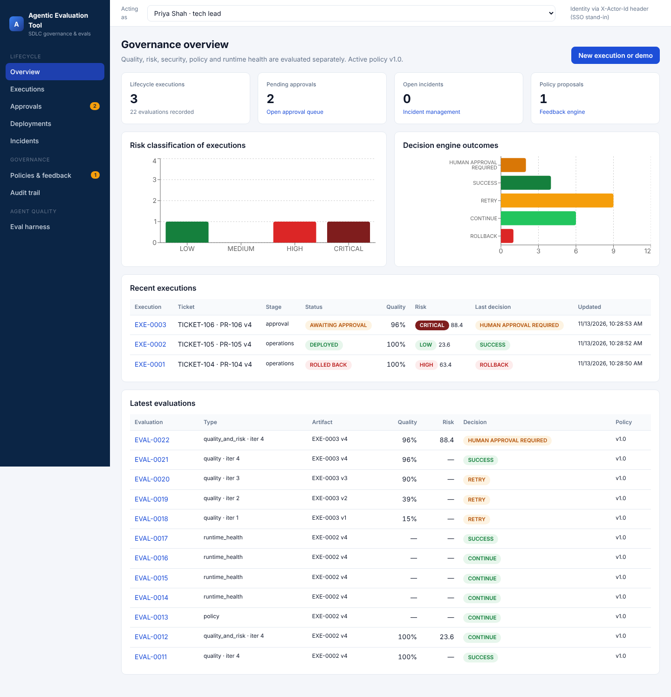
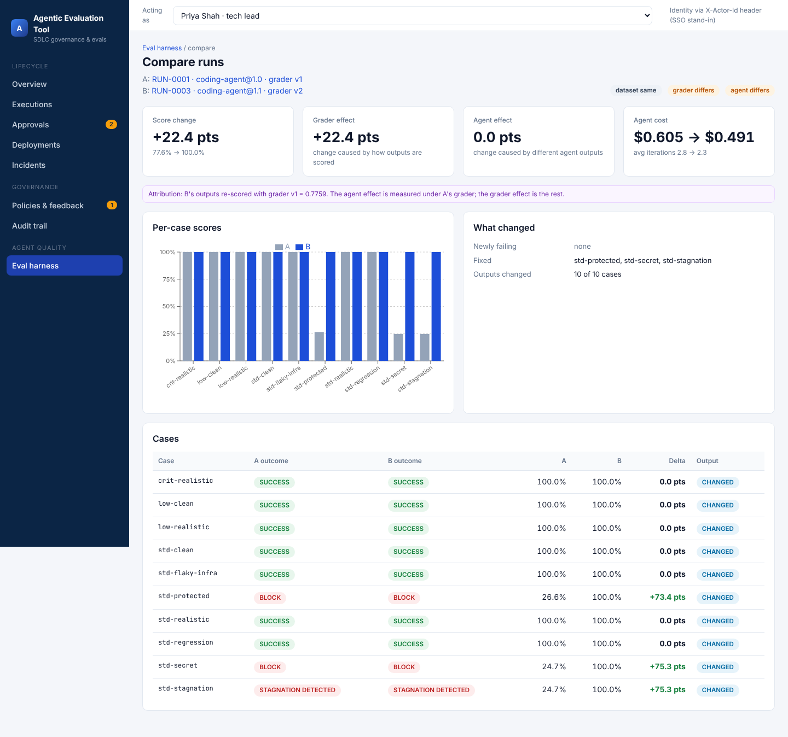
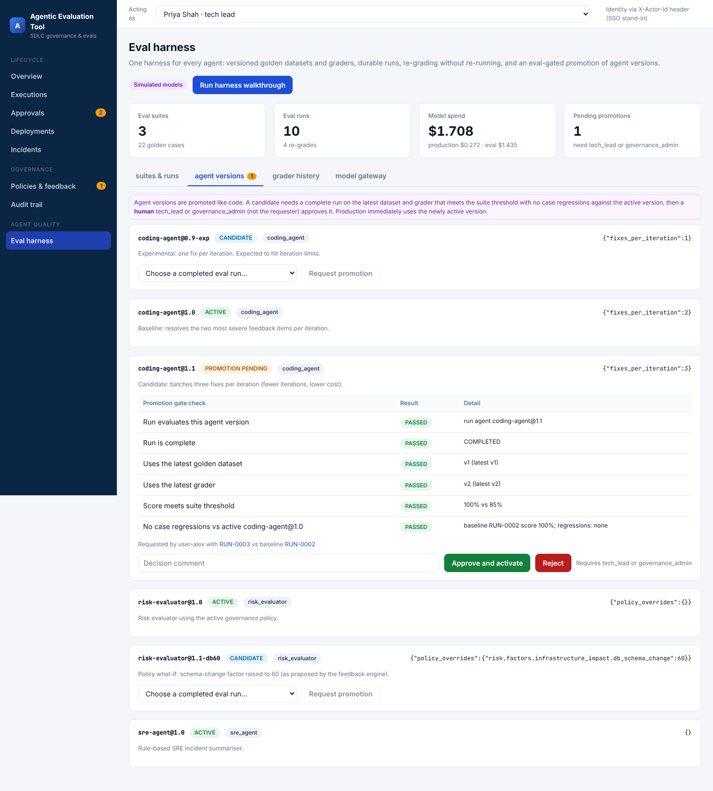

# Agentic Evaluation Tool: executive report

## In one paragraph

AI agents can already write code, ship releases and respond to incidents. The obstacle to using them on real systems is not capability. It is **trust and control**: who checked the work, who allowed it to ship, what happens when it goes wrong, and whether the agent is getting better or worse over time. The Agentic Evaluation Tool is a working prototype of that control layer. It independently checks every change an agent makes, routes risky changes to the right people, releases carefully and rolls back automatically, learns from incidents, and, with the new **eval harness**, measures the agents themselves before a new version is allowed into production.

## The problem it solves

| Without a control layer | With the Agentic Evaluation Tool |
|---|---|
| Agents grade their own work, or nobody does | Every change is checked by independent evaluators: tests, security, code quality, design rules and policy |
| A risky change looks the same as a trivial one | A Risk Gate scores the blast radius (LOW / MEDIUM / HIGH / CRITICAL) and explains why |
| Approval is a button anyone can press | Only the right role can approve, the approval is tied to the exact code reviewed, and agents can never approve |
| Problems are found by customers | A canary release watches live health and rolls back on its own |
| The same incident happens twice | Postmortems feed a learning loop that proposes rule changes for a human to accept |
| "The new agent seems better" | The eval harness proves it on a fixed test set before promotion, and a human signs off |
| AI spend is a surprise on the invoice | Every model call is priced and attributed to production or evaluation |

## What it does, step by step

1. **An engineer describes the work** as a ticket: what, why, how critical, which services it affects.
2. **A coding agent writes the change.** The tool evaluates it, sends precise feedback, and the agent fixes it. Quality climbs round by round, for example 15% → 70% → 92% → 100%. The loop stops on its own if the agent stalls, gets worse, runs out of budget or hits a hard rule.
3. **Hard rules are never traded for a good score.** A leaked password or an edit to protected governance files blocks the change outright, however good the rest looks.
4. **The Risk Gate decides who must look.** For example, a payment and login change scores 88/100 (CRITICAL) and needs both the Tech Lead and the Security Lead.
5. **People approve, with full context.** Reviewers see the diff, risk, tests and history. If the code changes after approval, the approval is cancelled automatically.
6. **Careful release.** The change goes to 5% of traffic, then 25%, 50% and 100%, and only while health stays green.
7. **Automatic rollback and incident handling.** On a breach, the tool rolls back, opens an incident and pages the on-call engineer.
8. **Learning loop.** When two incidents share a cause, the tool proposes a stricter rule, with the evidence. A governance admin approves it and the rulebook gets a new version.
9. **Everything is on the record.** Every action, including refused attempts, goes into a tamper-evident audit trail.

## What the eval harness adds

The lifecycle above checks **one change**. The eval harness checks **the agent**: it answers "is version 1.1 of our coding agent actually better than 1.0, and is it safe to switch?"

- **A fixed, versioned exam for each agent.** Each agent has a set of golden test cases with known right answers (10 for the coding agent, 8 human-labelled risk decisions, 4 incident summaries). The cases and the marking scheme are both versioned, so results stay comparable over time.
- **Runs that survive interruptions.** Long evaluations save progress case by case. They can be paused, resumed, capped by budget and retried after glitches. Work already done is reused rather than paid for again.
- **Separating "the agent got better" from "we changed the marking".** When a score moves, the tool says how much came from the agent and how much from the marking scheme. Without this, a team can believe an agent improved when only the measuring stick changed.
- **One meter for all AI spend.** Every model call, whether in production or in evaluation, is priced and attributed. Repeated identical calls are replayed from a cache for free.
- **Promotion like a code release.** A new agent version must pass the exam, show no regressions against the current version, and be approved by a Tech Lead or governance admin who did not request it. Production switches only then.

### What the walkthrough shows (measured in the prototype)

| Finding | Result |
|---|---|
| Changing only the marking scheme moved the coding agent from 77.6% to 100% | The tool attributed **all 22.4 points to the marking**, none to the agent |
| Candidate coding agent 1.1 against the current 1.0 | **Same quality**, agent cost **$0.605 → $0.491** (about 19% lower), average fix rounds **2.8 → 2.3** |
| Experimental agent 0.9 (one fix per round), run in full | Scored 72.7%, below the 85% bar, hitting round limits on 5 of 10 cases. The promotion gate **refuses it**, as an automated test confirms |
| Proposed stricter risk rule from incident learning, tested before adoption | Agreement with human risk labels rose from **85% to 92.5%** |
| Re-marking incident summaries with an AI judge a second time | **$0 extra cost**, same verdicts (replayed) |

## What this unlocks

1. **Safe adoption of AI agents on real systems.** Agents do the work. Independent checks, the right human sign-off and automatic rollback keep it safe. Agents can never approve or change the rules.
2. **Faster, cheaper delivery without losing control.** Low-risk changes flow through automatically. People spend their time only where the risk calls for it.
3. **Evidence-based agent upgrades.** Agent versions are promoted on measured results, with a person accountable. A worse agent cannot quietly reach production.
4. **Honest measurement.** The grader-versus-agent split stops teams from celebrating a better score that came from changing the test.
5. **Cost visibility and control.** Production and evaluation spend are visible separately, budgets stop runaway runs, and replay makes re-evaluation nearly free.
6. **Audit and compliance readiness.** Every decision has an owner, a reason, evidence and a tamper-evident record.
7. **Continuous improvement.** Incidents turn into proposed rule changes, which the harness can test before a human adopts them.

## Where it stands

| | Status |
|---|---|
| Working prototype: full lifecycle and eval harness | Done. 28 automated tests pass, CI is green |
| Runs locally with no cloud or API keys | Yes. See *Run it locally* |
| Real AI models | Not yet. The agents are deterministic simulations behind replaceable interfaces |
| Real systems (GitHub, monitoring, deployment tooling) | Not yet. These are simulated, with clear plug-in points |
| Enterprise sign-on | Not yet. Identity is chosen in the UI for the demo |

## Recommended next steps

1. Review and merge the two open pull requests (#1 the engine, #2 the eval harness).
2. Connect one real coding agent (for example, a Claude model) through the existing agent interface and run it through the same exam.
3. Connect one real repository and the monitoring source for a pilot service.
4. Add company sign-on and move the database to PostgreSQL for a shared environment.
5. Grow the golden test sets from real past tickets and incidents.

*The technical report has the full system specification, the architecture decisions and the open action items.*
