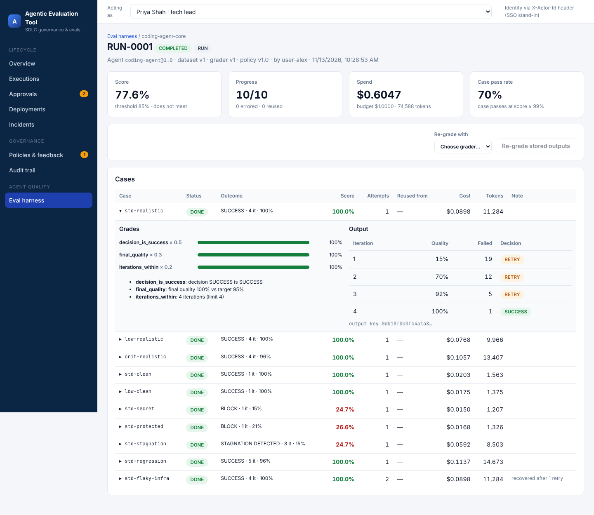

# Agentic Evaluation Tool: technical report

| | |
|---|---|
| Repository | `github.com/lekhashashank1704/Agentic-Evaluation-Engine` |
| Branches | `feat/governance-engine-prototype` (PR #1, engine), `feat/eval-harness` (PR #2, eval harness, stacked on #1), `docs/handover-eval-harness` (this package plus the rename, stacked on #2) |
| Codebase | Backend: about 6,000 lines of Python (`backend/app`). Frontend: about 2,200 lines of TypeScript/TSX (`frontend/src`) |
| Tests | 28 pytest tests (6 evaluators, 5 scoring and decisions, 8 lifecycle API, 9 eval harness). CI: `ruff check`, `pytest`, `npm ci && npm run build` |
| Runtime | Python 3.11+ and Node 18+. SQLite by default, PostgreSQL via `DATABASE_URL`. No external services or API keys |

## 1. Scope and system boundary

The system has two layers:

1. **The governance engine** controls and independently evaluates agent work on one change across the SDLC: ticket → coding/fix loop → Risk Gate → hash-bound human approval → canary release → Health Gate → rollback and incident → postmortem → policy proposal.
2. **The eval harness** evaluates agents as versioned artifacts. It runs agent versions on golden datasets with versioned graders, and gates their promotion to ACTIVE.

**Simulated:** the Coding/Fix, Release and SRE agents (deterministic), the deployment environment, telemetry, the dependency advisory snapshot, the model provider (behind the gateway) and the LLM judge.

**Real:** every evaluator executes real tools on the generated code. That is pytest against a governance-owned acceptance suite, Ruff, Radon, the AST/regex security rules, and Semgrep when installed. All synthetic evidence carries `simulated: true`.

## 2. Architecture

```
React SPA (Vite, Recharts) ── REST + X-Actor-Id ──► FastAPI
                                                     │
  api/routes.py ─────────────► orchestration/lifecycle.py ──► agents/ (Coding, Release, SRE; adapter interfaces)
  api/harness_routes.py ─┐                 │
                         │                 ▼
                         │       evaluation/engine.py  (central EvaluationEngine)
                         │         functional · security · code_quality · pr_review
                         │         risk · policy · health · decision · support (Evidence, Thresholds, History)
                         ▼
                 harness/ runner · targets · graders · suites · registry · gateway · demo
                         │
  core/ rbac (roles, AGENT_FORBIDDEN_ACTIONS) · common (ids, hash-chained audit, notify)
  services/ policies (versioned policy store) · incidents (postmortem, feedback engine)
                         │
                SQLAlchemy 2 ORM ──► SQLite / PostgreSQL
```

### Module map

| Path | Responsibility |
|---|---|
| `app/main.py` | App factory, lifespan seed, serves `frontend/dist` |
| `app/models.py` | ORM: tickets, executions, artifacts, evaluations, approvals, deployments, incidents, postmortems, policy versions and proposals, audit log, notifications, users; harness tables `model_calls`, `gateway_cache`, `eval_suites`, `eval_datasets`, `eval_graders`, `agent_versions`, `eval_runs`, `eval_case_results` |
| `app/schemas.py` | Pydantic v2: `EvaluationResult`, `Check`, `Evidence`, `RiskBreakdown`, `TicketCreate`, `SimulationControls`, … |
| `app/governance/default_policy.py` | Policy v1.0 seed (every weight, threshold, band, role and price) |
| `app/core/rbac.py` | Seed identities, permissions, `authorize()` with agent boundary, human-only and role checks; every denial audited |
| `app/evaluation/*` | Evaluators and the decision engine (section 4) |
| `app/orchestration/lifecycle.py` | Stage machine, fix loop, Risk Gate, approvals, release, health, rollback |
| `app/services/*` | Policy store (`active_policy` fills missing sections from defaults), incidents, feedback engine |
| `app/harness/*` | Eval harness (section 5) |
| `frontend/src/pages/*` | Overview, Executions, Execution detail, Evaluation, Approvals, Approval review, Deployments, Incidents, Governance, Audit, Harness, Harness run, Harness compare |

## 3. Lifecycle specification

**Execution states:** `CREATED → IN_PROGRESS → (BLOCKED | ESCALATED | AWAITING_APPROVAL | READY_FOR_RELEASE)`. Then `AWAITING_APPROVAL → (READY_FOR_RELEASE | CHANGES_REQUESTED → IN_PROGRESS | REJECTED)` and `READY_FOR_RELEASE → DEPLOYING → (DEPLOYED | ROLLED_BACK)`.

**Fix loop limits** (`policy.loop`): max 5 iterations, minimum improvement 0.02, stagnation window 2, regression tolerance 0, max 2 consecutive regressions, budget $2.00, 250k tokens, 300 s timeout, and a stop on critical security findings.

**Decision precedence:** BLOCK > SUCCESS > BUDGET_EXCEEDED > TIMEOUT > MAX_ITERATIONS_REACHED > STAGNATION_DETECTED > regression streak (ESCALATE) > RETRY.

**Release:** rollout steps 5 → 25 → 50 → 100%. The Health Gate checks error rate ≤ 1%, p95 ≤ 800 ms, p99 ≤ 1500 ms, CPU ≤ 80%, memory ≤ 85%, availability ≥ 99.9% and SLO ≥ 99%. A breach triggers ROLLBACK, an SRE incident and an on-call notification.

**Feedback engine:** two or more postmortems sharing a change category within 180 days produce a PENDING `PolicyProposal` that raises the mapped risk factor by 15 points. A `governance_admin` approval creates a new policy version (1.0 → 1.1).

## 4. Evaluation and scoring specification

**Quality objective** (development threshold 0.95): `0.7 × test_pass_rate + 0.2 × requirement_coverage + 0.1 × code_hygiene`. Mandatory gates PG-001 to PG-006 override the score.

**Security:** CRITICAL findings block. Severity points are CRITICAL 50, HIGH 30, MEDIUM 10, LOW 2. Semgrep is preferred when installed.

**Risk** = Σ (dimension score × weight). The weights are:

| Dimension | Weight |
|---|---|
| Code change impact | 0.20 |
| Dependency impact | 0.15 |
| Security exposure | 0.25 |
| Business criticality | 0.20 |
| Infrastructure impact | 0.20 |

The bands and what each one requires:

| Band | Score range | Decision | Required approvals |
|---|---|---|---|
| LOW | 0–30 | CONTINUE | none |
| MEDIUM | 31–60 | human approval | reviewer |
| HIGH | 61–80 | human approval | tech_lead |
| CRITICAL | 81–100 | human approval | tech_lead + security_lead |

Overrides (for example, a protected-path edit) force BLOCK.

**Approvals** store the artifact SHA-256. A new artifact version invalidates older approvals, and the release gate re-verifies the hash. The artifact author and the ticket owner cannot approve. Only the engine merges.

## 5. Eval harness specification

### 5.1 Data model

| Table | Key fields |
|---|---|
| `eval_suites` | id, target (`coding_agent` / `risk_evaluator` / `sre_agent`), pass_threshold |
| `eval_datasets` | suite_id, version, fixtures (JSON), sha256, notes, created_by |
| `eval_graders` | suite_id, version, spec `{graders:[{type, weight, …params}]}`, sha256 |
| `agent_versions` | id (`coding-agent@1.1`), target, config, status (ACTIVE / CANDIDATE / PROMOTION_PENDING / RETIRED / REJECTED), promotion record |
| `eval_runs` | suite, dataset, grader and agent versions; mode (`run` / `regrade`), parent_run_id, status (PENDING / RUNNING / PAUSED / COMPLETED / BUDGET_EXCEEDED), budget_usd, spent_usd, tokens, summary |
| `eval_case_results` | run_id, case_id, output_key, status (DONE / ERROR), attempts, reused_from, output, grades, score, passed, cost_usd, tokens, duration_ms, error |
| `model_calls` | caller (production / eval), agent, purpose, model, tokens, cost_usd, cache_hit, request_hash, run_id, execution_id |
| `gateway_cache` | request_hash → response |

### 5.2 Targets

Targets reuse production code. `run_coding_case` runs `SimulatedCodingAgent` (configured by the agent version) and `EvaluationEngine(persist=False)` in a harness-owned loop with the same limits. `run_risk_case` applies the version's `policy_overrides` to a copy of the policy, then runs `evaluate_security` and `evaluate_risk`. `run_sre_case` runs `SREAgent.summarize`.

### 5.3 Graders

| Grader | Description |
|---|---|
| `decision_is_success` | 1 if the decision is SUCCESS |
| `expected_decision` | 1 if the decision equals the label |
| `final_quality` | `quality / min_quality`; when `apply_to_all` is false, only cases expecting SUCCESS are scored |
| `iterations_within` | 1 within the limit, `1 − (n − limit) / limit` beyond it |
| `exact_risk_level` | 1 for an exact band match |
| `risk_level_distance` | 1 exact, 0.6 one band over, 0.4 one band under, 0 otherwise |
| `keyword_recall` | hits / expected points |
| `llm_judge` | rubric items met / rubric size, via `ModelGateway.complete` |

The case score is the weighted mean of its graders. A case passes at score ≥ 0.99. The run score is the mean of the case scores, and `meets_threshold` requires every case to be DONE and the score to be at least the suite threshold.

### 5.4 Runner semantics

- **Durability.** Each case is committed on completion. `execute()` skips DONE cases, so it is idempotent per case and safe to re-invoke.
- **Stop conditions,** checked before each case: a pause request, `max_cases` (→ PAUSED) and `spent_usd ≥ budget_usd` (→ BUDGET_EXCEEDED). A run can overshoot its budget by at most one case.
- **Retries.** `TransientError` is retried up to `policy.harness.max_retries` (2). The fixture field `transient_failures` injects failures for testing.
- **Reuse.** `output_key = sha256(fixture.input, agent id, agent config, suite)`. A DONE result with the same key in another run is reused at zero cost, with `reused_from` set.
- **Re-grade.** Re-grading creates a `regrade` run that re-scores the parent's stored outputs with another grader. Only judge calls are made, and the cache replays them.
- **Compare.** Compare gives per-case deltas, `new_failures`, `fixed`, and the efficiency of each run (agent cost, tokens, average iterations). Attribution works as follows. If only the grader differs, the whole delta is the grader effect. If only the agent differs, it is the agent effect. If both differ, B's outputs are re-scored with A's grader to get a midpoint M: the agent effect is M − A and the grader effect is B − M. If the datasets differ, the result is flagged as not comparable.

### 5.5 Promotion gate

`request_promotion` must be made by a human. The gate checks:

1. the run is for this version;
2. the run is COMPLETED;
3. it uses the latest dataset;
4. it uses the latest grader;
5. the score is at least the threshold;
6. new failures ≤ `promotion_max_case_regressions` (0), measured against the latest COMPLETED run of the ACTIVE version with the same dataset and grader. A missing baseline fails this check.

A pass sets PROMOTION_PENDING. `decide_promotion` requires a human with `promote_agent` and a role in `promotion_approval_roles` (tech_lead, governance_admin), who is not the requester. Approval sets the version ACTIVE and the previous version RETIRED. `promote_agent` is in `AGENT_FORBIDDEN_ACTIONS`. All steps are audited. The lifecycle resolves the active coding agent per execution (`active_coding_agent`) and records `agent_version` in the loop state.

### 5.6 Model gateway

`ModelGateway(db, policy)` provides `price()`, `meter()` (records calls made by the agent's own client) and `complete()` (calls through the gateway with record/replay keyed on `sha256(model + prompt)`). Prices come from `policy.gateway.prices_per_1k_tokens_usd`. `summary()` aggregates by caller and model.

### 5.7 Seeded suites and measured results (walkthrough)

| Suite | Run | Score |
|---|---|---|
| coding-agent-core (10 cases, threshold 85%) | 1.0 with grader v1 | 77.6% |
| | 1.0 re-graded with v2 | 100% (all grader effect, +22.4 pts) |
| | 1.1 with v2 | 100%; agent cost $0.605 → $0.491, average iterations 2.8 → 2.3 |
| | 0.9-exp with v2 | 72.7% |
| risk-calibration (8 cases, threshold 80%) | 1.0 with v1 | 75% |
| | 1.0 with v2 | 85% |
| | 1.1-db60 with v2 | 92.5% (fixes `std-high`) |
| sre-incident-summaries (4 cases, threshold 75%) | v1 | 81.3% |
| | v2 (with LLM judge) | 82.1%; a repeat re-grade costs $0 |

## 6. API surface

The lifecycle endpoints are listed in `docs/API.md` and the harness endpoints in `docs/EVAL_HARNESS.md#api`. Interactive OpenAPI docs are at `/docs`. Identity comes from the `X-Actor-Id` header.

## 7. Architecture decisions

| # | Decision | Rationale | Trade-off |
|---|---|---|---|
| AD-1 | Evaluation is separate from agents and enforced server side | No agent grades, approves or merges its own work | Every new agent action needs an RBAC entry |
| AD-2 | Mandatory gates are separate from weighted scores | A good score must never mask a critical finding | More decision states to explain (handled by `explanation`) |
| AD-3 | All tunables live in a versioned policy document read through `ThresholdManager` | Changes are reviewable, auditable and reversible | One JSON document; no schema validation of policy edits yet |
| AD-4 | Approvals bound to the artifact SHA-256 | An approval cannot carry over to different code | Any rework requires re-approval |
| AD-5 | Hash-chained, append-only audit log | Tamper evidence without external infrastructure | Single-writer chain; needs a different design at high write volume |
| AD-6 | Feedback engine proposes, never applies | Humans own policy | Slower adaptation |
| AD-7 | Deterministic simulated agents behind adapters | Reproducible demos and tests; no keys needed | Real-model behaviour is untested |
| AD-8 | SQLite with portable types, `DATABASE_URL` for Postgres | Zero-setup local runs | No Alembic migrations yet |
| AD-9 | The harness runs production modules (agents, engine) with `persist=False` | An eval measures what ships; no fork of logic | The harness loop duplicates the lifecycle's loop control (about 30 lines) |
| AD-10 | Datasets and graders are immutable and content-hashed | Results are reproducible and comparable | New versions are needed for any change |
| AD-11 | The grader is a first-class experiment variable (re-grade, attribution) | Separates measurement change from agent change | Attribution is a two-point decomposition, not a full Shapley split |
| AD-12 | Per-case commits instead of a workflow engine | Durability with no infrastructure | Runs execute inside the HTTP request |
| AD-13 | Output reuse keyed by content hash | Re-running unchanged work is free | The key excludes the policy version (see OA-2) |
| AD-14 | A single model gateway for production and eval | One price list, one meter, replay | Every new model client must go through it |
| AD-15 | Agent promotion requires an eval gate plus a separate human | Treats agent versions like code releases | Needs a baseline run of the active version first |
| AD-16 | `active_policy()` back-fills missing sections from defaults | Older databases keep working after upgrades | Defaults silently apply until a new policy version is approved |

## 8. Open action items

| ID | Priority | Item | Detail / proposed fix |
|---|---|---|---|
| OA-1 | High | Two price sources | The lifecycle loop budget uses `policy.loop.cost_per_1k_tokens_usd` (flat $0.012), while the gateway uses per-model prices. Derive the loop cost from `ModelCall` rows so one price list governs everything |
| OA-2 | High | Reuse key ignores policy version | Coding outcomes depend on policy thresholds. Add `policy_version` (or a hash of the relevant sections) to `output_key` so policy changes don't reuse stale outputs |
| OA-3 | High | Real identity | Replace `X-Actor-Id` with SSO/OIDC and map roles from the IdP |
| OA-4 | High | Real agent integration | Implement `CodingAgentAdapter` and `LLMClient` with a real model, routed through `ModelGateway.complete`. Run it on `coding-agent-core` as a CANDIDATE |
| OA-5 | Medium | Async execution | Move `execute()` and the lifecycle onto a worker queue (Celery, RQ, Temporal); the API returns run ids and the UI polls. The runner is already resumable |
| OA-6 | Medium | Schema migrations | Add Alembic. Existing databases do not receive new seeded permissions (`promote_agent`) without a reset |
| OA-7 | Medium | Risk calibration gap | `crit-high` is still under-estimated (HIGH vs labelled CRITICAL) under every evaluator version. Review the factor points or labels with security |
| OA-8 | Medium | SRE summary recall | `errors-auth` scores 50 to 57%. Improve the SRE agent's category-specific recommendations |
| OA-9 | Medium | Golden data from real history | The fixtures and labels are synthetic. Build datasets from past tickets, incidents and reviewer decisions |
| OA-10 | Medium | Policy edit validation | Validate policy documents against a JSON schema before activation |
| OA-11 | Low | Gateway retention | `model_calls` grows unbounded. Add pagination, aggregation and retention |
| OA-12 | Low | Frontend bundle size | 674 kB. Code-split Recharts and the pages; opt into the React Router v7 future flags to silence the console warnings |
| OA-13 | Low | Windows run guide | The steps are written but not yet executed on Windows |
| OA-14 | Low | Attribution method | Consider symmetric (both-order) attribution when grader and agent both change |

## 9. Verification performed

- `ruff check .` is clean, `pytest` passes 28 tests, and `npm run build` (tsc + vite) succeeds. CI is green on PR #2.
- A clean-clone run followed the *Run it locally* guide on Linux (Python 3.13, Node 22): install, tests, build, server start, `scripts/demo.sh` (9 scenarios) and the harness walkthrough.
- UI checks in headless Chromium, with screenshots in `docs/screenshots/`.


